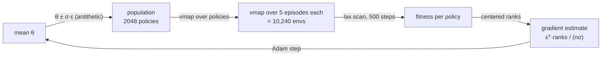

# swarm-es

**Evolution strategies over 10,000+ parallel environments, written in pure JAX.**

Instead of training one agent with backprop, swarm-es keeps a *population* of
thousands of neural-network policies, drops each one into its own copy of a
physics environment, and runs them all at once on a single device. The
policies that do well pull the search distribution toward themselves; the
rest are forgotten. No gradients flow through the environment, no replay
buffer, no value function.

The interesting part is how little code that takes in JAX: the environment
is a pure function, one episode is a `lax.scan`, and `jax.vmap` turns "one
episode" into "a whole generation" without touching the env code.

## The drone task

`Drone` is an original planar quadrotor environment. Two rotors, each with
its own thrust. The only way to move sideways is to spin the rotors
unevenly, tilt, and let the thrust vector do the work. Gusty
Ornstein-Uhlenbeck wind keeps pushing it off course.

- Fly to the gold star. Reach it (within 30 cm) for +5 and a new star appears.
- Leave the 8 x 8 m arena or tip past 90 degrees and the episode ends.
- 500 steps (10 s at 50 Hz) per episode.

A `Pendulum` swing-up env (same dynamics and cost as Gym's `Pendulum-v1`) is
included as a sanity check, since its returns are well known: random is
about -1200, solved is about -150.

## How one generation works



Every arrow above runs inside one `jax.jit`. Ten generations at a time are
wrapped in a `lax.scan`, so Python only wakes up to print a log line.

| piece | file | idea |
|---|---|---|
| environments | `swarm_es/envs/` | state is a `NamedTuple`, `step` is a pure function |
| rollout | `swarm_es/rollout.py` | one episode = one `lax.scan`; crashed envs freeze in place |
| policy | `swarm_es/policy.py` | tanh MLP flattened to one vector with `ravel_pytree` |
| optimizer | `swarm_es/es.py` | OpenAI-ES: antithetic sampling, rank shaping, Adam |
| training | `swarm_es/train.py` | `vmap(vmap(rollout))` + `lax.scan` over generations |
| speed test | `swarm_es/bench.py` | env-steps/sec as the number of parallel envs grows |

## Run it

```bash
pip install -e ".[dev]"            # CPU
pip install -e ".[dev,cuda]"       # NVIDIA GPU (Linux)

pytest -q                                               # tests
python -m swarm_es.train --env pendulum --pop 1024 --gens 150
python -m swarm_es.train --env drone                    # 2048 x 5 = 10,240 envs/gen
python -m swarm_es.render --run runs/drone --episodes 3 # GIFs
python -m swarm_es.bench --env drone                    # throughput scaling
```

On Colab, pick a GPU or TPU runtime, then:

```bash
!git clone https://github.com/shiroonigami23-ui/jax-swarm-es && cd jax-swarm-es && pip install -e .
!python -m swarm_es.train --env drone --gens 500
```

Each run writes `params.npz`, `config.json`, `history.csv` and
`learning_curve.png` to `runs/<env>/`.

## Results

Not filled in yet. The first full training runs, learning curves, drone
GIFs and GPU throughput numbers will go here. CI already runs the test
suite, a short pendulum training run and a CPU benchmark on every push
(artifacts are attached to each workflow run).

## Why ES and not PPO?

- **Embarrassingly parallel.** Fitness evaluations don't talk to each other, so
  the population maps straight onto `vmap`.
- **No backprop through time.** Only episode returns are needed, so long
  horizons, sparse rewards and non-differentiable crashes are fine.
- **The trade-off:** it is sample-hungry. Millions of env steps per
  generation is only affordable because the env runs on the accelerator next
  to the policy.

## References

- Salimans et al., *Evolution Strategies as a Scalable Alternative to Reinforcement Learning*, 2017.
- Wierstra et al., *Natural Evolution Strategies*, JMLR 2014.
- Freeman et al., *Brax: A Differentiable Physics Engine for Large Scale Rigid Body Simulation*, 2021.
- Lange, *gymnax: A JAX-based Reinforcement Learning Environment Library*, 2022.

## License

MIT
