# JAX Swarm ES

Evolution strategies (ES) over thousands of parallel environments, written in pure **JAX**. A population of neural-network policies is dropped into thousands of copies of a physics environment at once, and the policies that do well pull the search distribution toward themselves. No backprop through the environment, no replay buffer, no value function.

The environment is a pure function, one episode is a `lax.scan`, and `jax.vmap` turns one episode into a whole generation without touching the environment code.

## 📊 Results

All numbers below come from the files in [`results/`](results/). The tables directly below are from a Colab **CPU** runtime. The **GPU results** further down are from a Tesla T4: the same drone training finishes in **1.5 minutes**, and env throughput reaches **15.1M steps/s**, about **34x** the CPU at 65,536 envs.

| Task | Setup | Start | Best | Final (gen) | What it means |
| :--- | :--- | :---: | :---: | :---: | :--- |
| **Drone** | pop 2048 × 5 episodes = 10,240 envs/gen, 500 gens | return −4, 0 targets | return 87 (gen 324) | return 75, **9 targets** (gen 500) | Learns to chase waypoints through gusty wind |
| **Pendulum** | pop 1024 × 5 episodes, 150 gens | −1279 | −693 (gen 92) | −809 (gen 150) | Improved, but **not solved yet** (solved ≈ −150) |

**Drone.** The policy goes from crashing to reaching about 9 waypoints per 10-second episode. Most of the learning happens in the first ~40 generations, then it plateaus around a return of 75.

**Pendulum.** It plateaued around −770, well short of the ≈ −150 that counts as solved. It most likely settled into a local optimum (spinning or partial swings) instead of balancing upright. Next things to try: more generations and a larger `--sigma` (e.g. 0.1).

### Training curves

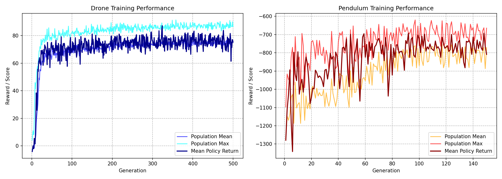

### Throughput scaling (CPU)

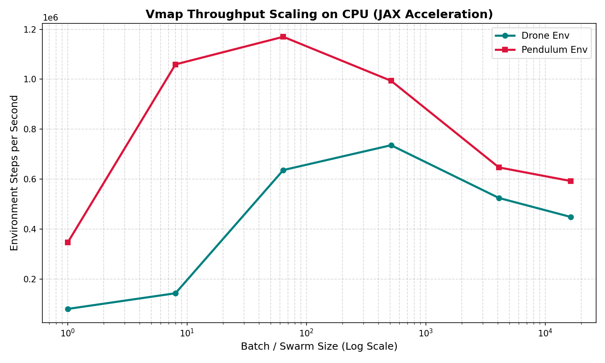

Drone benchmark from [`results/bench/drone_cpu.csv`](results/bench/drone_cpu.csv), one full 500-step episode per env:

| Parallel envs | Time per batch | Env steps / s |
| ---: | ---: | ---: |
| 1 | 0.005 s | 94k |
| 64 | 0.10 s | 335k |
| 1,024 | 0.72 s | **708k** |
| 8,192 | 7.9 s | 519k |
| 32,768 | 37.4 s | 438k |
| 65,536 | 74.3 s | 441k |

On CPU, throughput peaks around 1,024 envs and then falls off as the batch outgrows the cache. On the T4 it keeps climbing and only levels off past 8k envs (see GPU results below).

<!-- GPU-RESULTS:START -->
### GPU results (Tesla T4)

_Generated by `colab_run.py` on 2026-10-26. Raw data in [`results/gpu/`](results/gpu/)._

| Task | Config | Start | Best (gen) | Final | Last-10 avg | Wall time |
| :--- | :--- | :---: | :---: | :---: | :---: | ---: |
| Drone | --pop 2048 --n-eval 5 --gens 500 | -4.1 | 86.6 (468) | 77.0, 9.2 targets | 75.1, 8.7 targets | 1.5 min |
| Pendulum | --pop 2048 --n-eval 5 --gens 400 --sigma 0.1 | -1278.5 | -678.5 (92) | -798.3 | -779.9 | 0.5 min |

Pendulum status: **improved, still not solved (solved ≈ −150)**.

**Throughput.** Peak GPU throughput was **15,109,264 env-steps/s at 65,536 parallel envs**.

| Parallel envs | GPU env-steps/s | CPU env-steps/s | GPU / CPU |
| ---: | ---: | ---: | ---: |
| 1 | 24,954 | 94,338 | 0.3x |
| 64 | 1,424,239 | 334,636 | 4.3x |
| 1,024 | 8,512,947 | 707,976 | 12.0x |
| 8,192 | 14,411,090 | 519,097 | 27.8x |
| 32,768 | 15,013,070 | 438,103 | 34.3x |
| 65,536 | 15,109,264 | 440,727 | 34.3x |

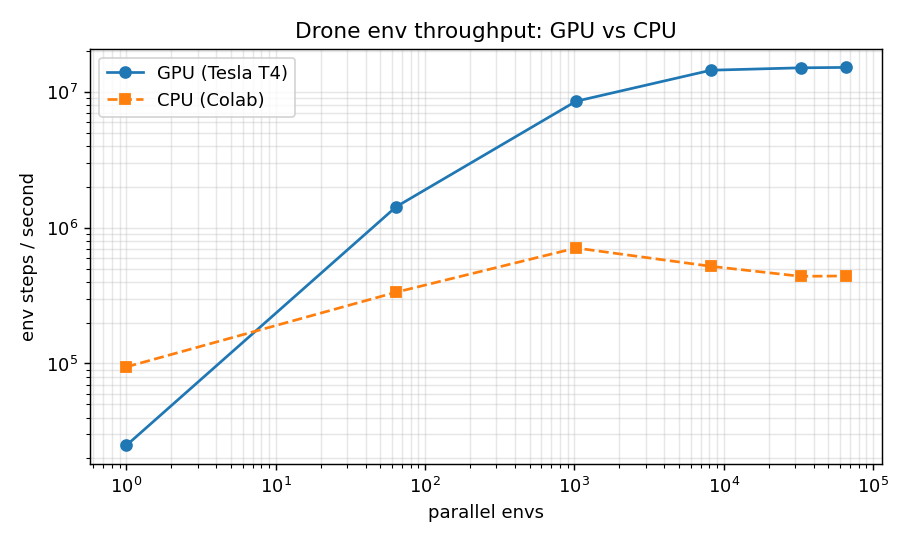

| Drone learning curve | Pendulum learning curve |
| :---: | :---: |
| 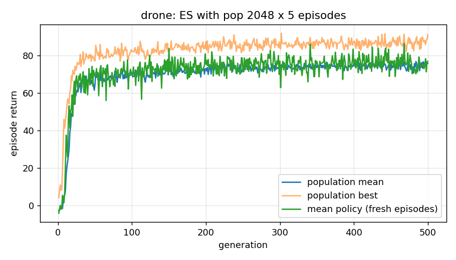 | 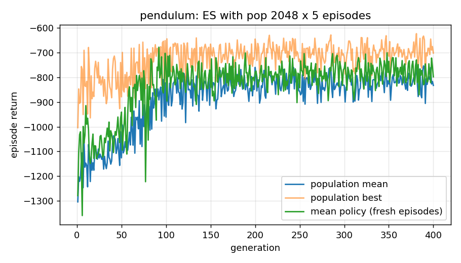 |

| Episode 0 | Episode 1 | Episode 2 |
| :---: | :---: | :---: |
|  |  |  |
| 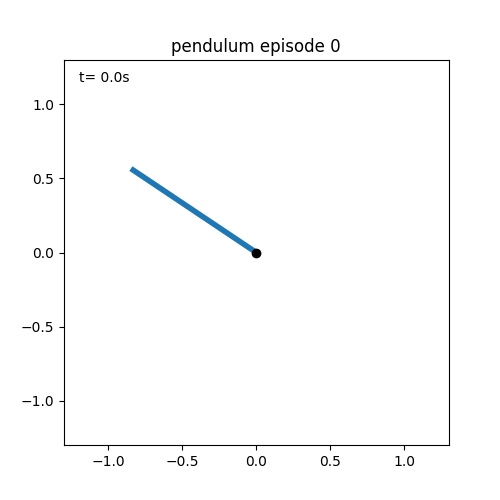 |  |  |
<!-- GPU-RESULTS:END -->

<!-- SWEEP-RESULTS:START -->
### Hyperparameter sweep

Not run yet. `colab_run.py --sweep` fills this section in.
<!-- SWEEP-RESULTS:END -->

---

## 🎬 Environment Simulations

### Drone waypoint chasing

An original planar quadrotor environment. Two rotors with independent thrust, so the only way to move sideways is to tilt by spinning them unevenly. Ornstein-Uhlenbeck wind gusts keep pushing it off course. Reaching the gold star (within 30 cm) gives +5 and spawns a new one. Leaving the 8 × 8 m arena or tipping past 90° ends the episode. Each episode is 500 steps (10 s at 50 Hz).

| Episode 0 | Episode 1 | Episode 2 | Episode 3 | Episode 4 |
| :---: | :---: | :---: | :---: | :---: |
| 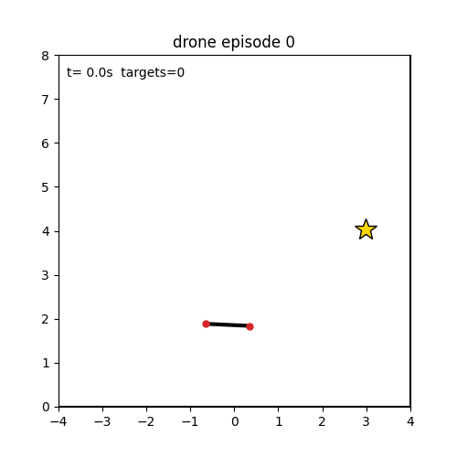 | 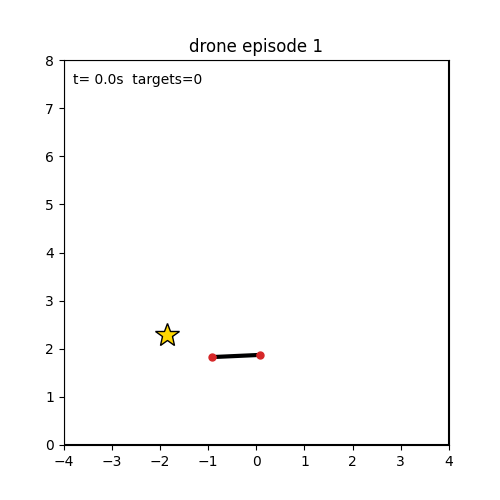 | 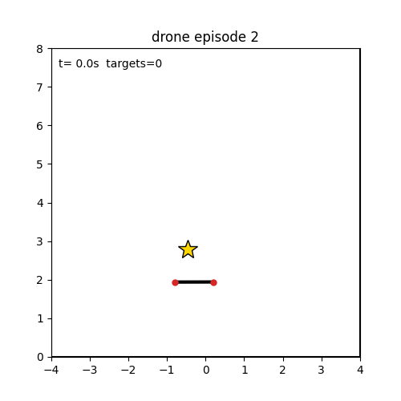 | 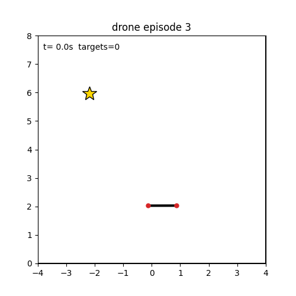 | 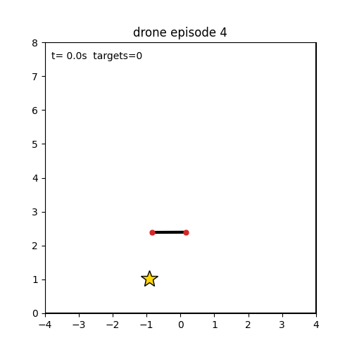 |

### Pendulum swing-up (work in progress)

Same dynamics and cost as Gym's `Pendulum-v1`, so the returns are comparable (random ≈ −1200, solved ≈ −150). These GIFs show the current, **unsolved** policy.

| Episode 0 | Episode 1 | Episode 2 | Episode 3 | Episode 4 |
| :---: | :---: | :---: | :---: | :---: |
|  | 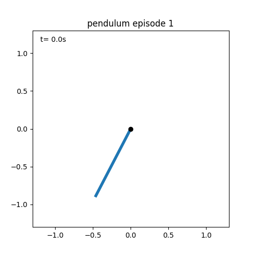 | 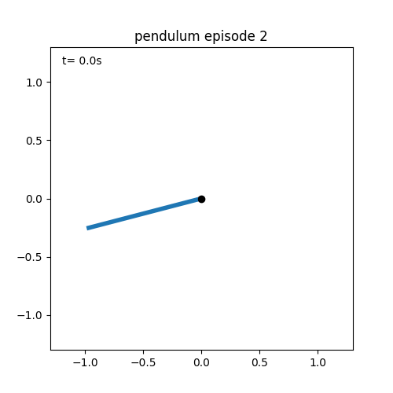 | 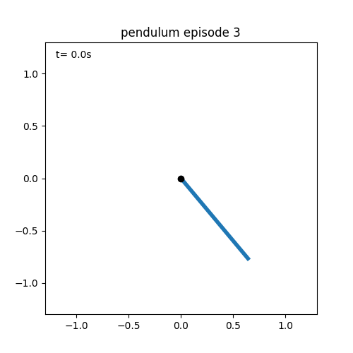 | 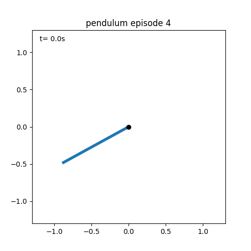 |

---

## 🧠 How one generation works

This repository implements **OpenAI-ES** (Salimans et al., 2017) entirely as jitted JAX functions.

```
               +-----------------------+
               |   Mean parameters θ   |
               +-----------+-----------+
                           |  θ ± σ·ε  (antithetic noise)
                           v
         +-------------------------------------+
         |  Population: 2048 policies          |
         +-----------------+-------------------+
                           |  vmap over policies × vmap over 5 episodes
                           v
     +---------------------------------------------+
     |  10,240 environments, 500 steps each        |
     |  one lax.scan per episode, all in one jit   |
     +---------------------+-----------------------+
                           |  episode returns
                           v
         +-------------------------------------+
         |  Centered-rank fitness shaping      |
         +-----------------+-------------------+
                           |  gradient estimate  εᵀ·ranks / (nσ)
                           v
               +-----------------------+
               |      Adam step on θ   |
               +-----------------------+
```

Ten generations at a time are wrapped in a single `lax.scan`, so Python only wakes up to print a log line.

| Piece | File | Idea |
| :--- | :--- | :--- |
| Environments | `swarm_es/envs/` | state is a `NamedTuple`, `step` is a pure function |
| Rollout | `swarm_es/rollout.py` | one episode = one `lax.scan`; crashed envs freeze in place |
| Policy | `swarm_es/policy.py` | tanh MLP flattened to one vector with `ravel_pytree` |
| Optimizer | `swarm_es/es.py` | antithetic sampling, centered ranks, Adam |
| Training | `swarm_es/train.py` | `vmap(vmap(rollout))` + `lax.scan` over generations |
| Benchmark | `swarm_es/bench.py` | env steps/s as the number of parallel envs grows |

---

## 🛠️ Installation

Requires Python 3.10+.

```bash
git clone https://github.com/shiroonigami23-ui/jax-swarm-es.git
cd jax-swarm-es
pip install -e ".[dev]"
```

For an NVIDIA GPU on Linux, install the CUDA build of JAX, then check that JAX actually sees the GPU:

```bash
pip install -U "jax[cuda12]"
python -c "import jax; print(jax.devices())"   # should list a CUDA device, not CpuDevice
```

On Colab, run the install, restart the runtime, then run the check. If it still prints `CpuDevice`, everything will silently run on CPU.

---

## 💻 Usage

```bash
pytest -q                                                        # tests

python -m swarm_es.train --env drone --gens 500                  # 2048 x 5 = 10,240 envs/gen
python -m swarm_es.train --env pendulum --pop 1024 --gens 400 --sigma 0.1

python -m swarm_es.render --run runs/drone --episodes 5          # GIFs
python -m swarm_es.bench --env drone --sizes 1 64 1024 8192 32768
python -m swarm_es.sweep --env pendulum --lrs 0.005 0.01 0.02 0.05 --sigmas 0.03 0.1 --lr-decays 1.0 0.995
```

Each training run writes `params.npz`, `config.json`, `history.csv` and `learning_curve.png` to `runs/<env>/`. To load trained parameters:

```python
import numpy as np
params = np.load("runs/drone/params.npz")["mean"]   # flat parameter vector
```

### Training flags

| Flag | Meaning | Default |
| :--- | :--- | :---: |
| `--env` | `drone` or `pendulum` | `drone` |
| `--pop` | population size (must be even) | 2048 |
| `--n-eval` | episodes per member; `pop × n-eval` envs run in parallel | 5 |
| `--gens` | generations | 300 |
| `--sigma` | std of the Gaussian parameter noise | 0.05 |
| `--lr` | Adam learning rate on the mean | 0.02 |
| `--weight-decay` | L2 pull on the mean | 0.005 |
| `--lr-decay` | multiply lr by this every generation | 1.0 (off) |
| `--sigma-decay`, `--sigma-min` | multiply sigma by this every generation, never below the min | 1.0, 0.0 |
| `--hidden` | hidden layer sizes | `32 32` |
| `--log-every` | generations per jitted chunk / log line | 10 |
| `--seed` | random seed | 0 |

The results above used the defaults, except `--gens 500` for the drone and `--pop 1024 --gens 150` for the pendulum. Exact configs are in `results/<env>/config.json`.

---

## 🚀 JAX tips

1. **GPU memory.** JAX pre-allocates most of the GPU memory at startup. If you share the GPU with something else, turn that off:
   ```bash
   export XLA_PYTHON_CLIENT_PREALLOCATE=false
   ```
2. **Compilation cache.** Reuse compiled programs across runs:
   ```bash
   export JAX_COMPILATION_CACHE_DIR=/tmp/jax_cache
   ```
3. **First generation is slow.** The first call compiles the whole generation with XLA; later calls reuse it.

## ❓ FAQ

**I get a `ConcretizationTypeError` / tracer error.** Inside jitted code, array shapes and Python `if` conditions must not depend on traced values. Use `jnp.where`, `jax.lax.cond` or `jax.lax.select` instead.

**Why ES instead of PPO?** Fitness evaluations are independent, so the population maps straight onto `vmap`. Only episode returns are needed, so long horizons and non-differentiable crashes are fine. The cost is sample hunger: millions of env steps per generation, which is only affordable because the env runs on the same device as the policy.

## References

- Salimans et al., *Evolution Strategies as a Scalable Alternative to Reinforcement Learning*, 2017.
- Wierstra et al., *Natural Evolution Strategies*, JMLR 2014.
- Freeman et al., *Brax: A Differentiable Physics Engine for Large Scale Rigid Body Simulation*, 2021.
- Lange, *gymnax: A JAX-based Reinforcement Learning Environment Library*, 2022.

## License

MIT
